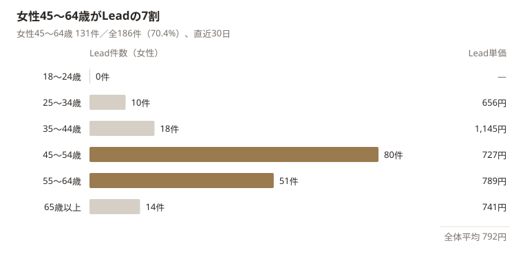

# Joli Skin Clinic｜たるみ設計カウンセリング 動画広告 完成案

2026年10月29日 ／ 社内検討用の資料です。クリニックの公式ページではありません。

## 要点

たるみ設計カウンセリング（5,500円）向けに縦型動画を3本作り、11月9日ごろから2週間、現行の画像広告03と並べて配信したい。本命は常深代表が話すA、最初に出せるのは今ある写真で作るC。

| 案 | 内容 | 位置づけ |
|---|---|---|
| A「結局どれがいいの？」 | 常深代表が「自分では分からない、先生に診てもらって」と話す（約25秒） | 本命。元データと許可が必要 |
| B「たるみの原因は人それぞれ」 | 長谷川副院長が5つの原因を示し、医師が診る価値を語る（約25秒） | 対抗。新院での撮影が必要 |
| C「決める前に、相談だけ。」 | 新院の写真に、60分の流れと持ち帰れるものを重ねる（約20秒） | 今ある素材で先行 |

### 今回新たに分かったこと

- 院の発信で反応が大きいのは「結局どれがいい？」と「実は原因は○○」の型（YouTube 5.5万・2.0万回、Instagram 1.6万・1.3万回）。LP冒頭の「情報を集めるほど何を選ぶべきかわからなくなる」と同じ悩み。
- 常深代表と長谷川副院長は、LPと同じ結論（先生に診てもらう・原因は人それぞれ）を本人の言葉で既に話している。前回案のテロップより、この発言を使う方が信頼を作りやすい。
- 2026年8月に移転しており、7月以前の発信の多くは旧院で撮影されている。新院の素材は院内写真と「顔タイプ別」動画などに限られる。

前提として、現在のLead（186件・単価約792円）は予約ボタンのクリックで、予約完了ではない。動画の優劣は、院から予約完了の件数をもらって最終判断する。

### 判断してほしいこと

1. この3案（代表・副院長が出演するA・Bを含む）で進めてよいか。
2. 院への依頼（字幕なし元データ、副院長の約20秒の撮影、予約完了数の週次共有）を出してよいか。誰から依頼するか。
3. 「実質無料」「キャッシュバック」を動画に入れない方針でよいか。

## 1. 現状分析：LPとMeta広告（直近30日）

直近30日（9/29〜10/28）のたるみ広告は、広告費147,401円でLead186件、Lead単価は約792円。ただしこのLeadは予約サイト・LINEへのボタンクリックで、5,500円カウンセリングの予約完了ではない。

### LPが売っているもの

対象LP：[たるみ設計カウンセリング](https://osaka.kyoto-sclinic.com/lp/tarumi-counseling/)。機械名を選ぶ前に医師が原因を診て、治療方針と見積もりを出す「施術前の判断支援」を商品にしている。

| 項目 | LP・予約ページの内容 | 動画での扱い |
|---|---|---|
| 料金 | 5,500円（税込）。施術費は別 | 「相談の料金」と明示し、施術価格と誤解させない |
| 時間・担当 | 約45〜60分。医師が診察・治療設計 | 医師に直接相談できる価値として見せる |
| 含まれるもの | 肌画像解析、ベクトラ3D画像分析、治療設計、見積もり | 5,500円で何が手に入るかの具体化に使う |
| 安心材料 | 無理な勧誘なし、即決不要、設計図・見積もりを持ち帰れる | 初めての人・契約が不安な人への入口 |
| 相談料の充当 | 当日に施術契約した場合、施術費から5,500円を差し引く | 「実質無料」と書くなら当日契約の条件をセットで |
| 場所 | 大阪上本町（上六Fビル地下1階） | 通院できる人に絞る情報として最後に出す |
| 期限 | キャンペーン価格は11月末まで | 12月以降に配信するなら条件を再確認 |

10月29日に再確認したLPは、冒頭に「移転リニューアル」の帯と「他院のハイフや糸リフトで効果を感じなかった方へ」を置き、「情報を集めれば集めるほど、何を選ぶべきかわからなくなる」と続けている。相談の流れは「画像解析 約10分 → 医師の診察 約20分 → 治療設計・見積もり 約15〜20分」と示され、動画Cはこの流れをそのまま使う。

### 広告の成果と、CVの定義の注意

| 指標（たるみ広告セット） | 直近30日 |
|---|---:|
| 広告費 | 147,401円 |
| リーチ／平均表示頻度 | 30,663人／2.60回 |
| リンククリック（CTR） | 2,680件（3.36%） |
| LP閲覧（単価） | 2,206件（約67円） |
| Lead（単価） | 186件（約792円） |
| Lead ÷ LP閲覧 | 8.43% |
| 5,500円の予約完了・来院 | 取得データでは確定できない |

- LeadはLPの予約ボタン・LINEボタンのクリックで送られる。予約完了ではない。
- 「キレイパス予約完了（Schedule）」のカスタムCVはあるが、広告に帰属した件数は取得できなかった。計測故障とも予約ゼロとも断定できない。
- 旧URL条件のカスタムCV（2,680件）はリンククリックと同数で、CVとして使わない。
- 動画の評価には、予約管理側のメニュー別予約完了・来院・売上との照合が必要。

### 訴求別の反応（稼働3広告、いずれも画像広告）

| 広告 | 訴求 | 広告費 | Lead | Lead単価 | リンクCTR | Lead ÷ LP閲覧 |
|---|---|---:|---:|---:|---:|---:|
| 03 | 初めてのたるみ治療への安心、医師が丁寧に診察、無理な勧誘なし | 128,360円 | 163 | 787円 | 3.36% | 8.20% |
| 02 | 原因を見極め、一人ひとりに合った治療を提案 | 16,383円 | 22 | 745円 | 3.58% | 11.00% |
| 04 | 医師と方針を整理、画像分析、選択肢と見積もり、45〜60分 | 2,658円 | 1 | 2,658円 | 2.37% | 5.26% |

03が広告費の87%・Leadの88%を占め、「初めてでも安心」で量を作れている。02は単価・LP閲覧後の反応がやや良く、「原因を診て自分に合う方法を知る」も有望。04は配信量が少なく（LP閲覧19件）、良し悪しは判断できない。単語単位の成果データはなく、広告全体の比較である。

### 配信面と推移

| 配信面 | 広告費 | Lead | Lead単価 |
|---|---:|---:|---:|
| Instagram ストーリーズ | 25,137円 | 37 | 679円 |
| Threads フィード | 45,807円 | 65 | 705円 |
| Instagram リール | 11,236円 | 13 | 864円 |
| Instagram フィード | 57,819円 | 60 | 964円 |

ストーリーズの単価が最も良く、縦型動画を試す根拠になる。Threadsも全Leadの約35%を担う。Lead単価は前半（9/29〜10/14）627円から後半（10/15〜10/28）1,149円に悪化したが、直近7日は1,022円で前週より改善しており、広告疲労とは断定できない。

## 2. 誰に向けるか

動画の中心は大阪通院圏の45〜64歳女性。Leadの7割を占め、Lead単価も全体平均を下回る。

Meta広告 たるみ広告セット・2026年9/29〜10/28・女性の年齢区分別（男性・不明13件は除く）

55〜64歳はリンクCTRが4.76%と最も高く、動画の終わりの案内まで見てもらえる余地がある。配信対象は狭めず、映像と言葉の中心をこの層に合わせる。大きめの文字、ゆっくりした切り替え、全発言の字幕を基本にする。

### 想定する人

- 第一：たるみが気になり、何を受けるべきか決めきれず、医師に相談したい人。
- 第二：機器名を調べて比べているが、予算や負担まで含めて判断できない人。
- 検証：過去の施術に納得できず、別の方針を知りたい人。LP冒頭はこの層向けだが、広告での実績はまだない。

### 訴求の優先順位と担う案

| 優先 | 訴求の軸 | 根拠 | 担う案 |
|---|---|---|---|
| 1 | 初めてでも、治療を決めずに医師に相談できる | 広告03の量、LPの即決不要・勧誘なし | C、A・Bの締め |
| 2 | 機械を選ぶ前に、原因と自分に合う方針を知る | 広告02の単価・LP閲覧後の反応、院の発信の上位テーマ | A・B |
| 3 | 施術選びを見直したい人への相談 | LP冒頭「他院のハイフや糸リフトで効果を感じなかった方へ」 | Aのフック違いA3で検証 |

どの案も「5,500円で、医師に相談し、自分に合う治療方針と見積もりを持ち帰る」という価値を共通で伝える。価格だけ、機械名だけ、変化の映像だけには寄せない。

## 3. 院の発信から分かったこと（YouTube・Instagram・公式サイト）

院の発信で反応が大きいのは「結局どれがいい？」と「実は原因は○○」の2つの型で、どちらもLPの主張（機械を選ぶ前に原因を診る）と同じ。しかも常深代表と長谷川副院長が「先生に診てもらって」「原因は人それぞれ」と、動画の結論を本人の言葉で既に話している。前回案のテロップを作るより、この発言を広告に使う方が強い。

### 反応が大きい投稿（2026年10月29日時点の再生数）

| チャネル | 投稿 | 再生数 | 型 |
|---|---|---:|---|
| YouTube（常深代表） | [たるみ治療で迷ったら見て！ザーフとボルニューマを同日に](https://www.youtube.com/watch?v=z_JFZzyv28s) | 5.5万 | 迷い・比較 |
| YouTube（常深代表） | [実は脂肪じゃない…口横ぽにょの原因は](https://www.youtube.com/watch?v=hhmrR7_5hbo) | 2.0万 | 原因 |
| Instagram（公式） | [常深代表イチ押し 輪郭追い込みセット](https://www.instagram.com/reel/DSUD-cnkd9n/) | 1.7万 | 代表の推し |
| Instagram（公式） | [モフィウスとソフウェーブ、どっちがいいの？](https://www.instagram.com/reel/DWQ28f7E0Xv/) | 1.6万 | 迷い→「悩みで選ぶ」 |
| Instagram（公式） | [ザーフ×独自の5アプローチ](https://www.instagram.com/reel/DS13CTmE32p/) | 1.5万 | 設計・こだわり |
| Instagram（公式） | [HIFUとソフウェーブ、どっちがいいの？](https://www.instagram.com/reel/DXYr44Wk6B2/) | 1.3万 | 迷い→「カウンセリングで確認」 |
| YouTube（常深代表） | [40代必見！結局どれがいい？たるみ治療機器を全部比較](https://www.youtube.com/watch?v=d7NgZVVPHYs) | 1.1万 | 迷い |
| Instagram（長谷川医師） | [鏡を動かすだけでたるみ進行度をチェック](https://www.instagram.com/reel/DTUGSFfEwHG/) | 4,524 | セルフチェック |
| Instagram（長谷川医師） | [たるみの原因5選（鏡でチェック）](https://www.instagram.com/reel/DSUYok4ifwc/) | 4,305 | 原因・セルフチェック |
| YouTubeショート | [首が動いたらハイフ適用です](https://www.youtube.com/shorts/73ZMjYGTVB0) | 3,800 | 自分で分かる |

常深代表のチャンネル（[@nurse_tuneyu](https://www.youtube.com/@nurse_tuneyu)、登録者2,070人・224本）では、上位のほぼすべてが「迷い・比較」か「原因」。公式Instagram（[@joli_skin_clinic](https://www.instagram.com/joli_skin_clinic/)、フォロワー6,489人）の「どっちがいいの？」系も、結論は「悩みで選ぶ」「カウンセリングで一緒に確認」で終わる。再生数は広告成果ではないが、通院圏の関心が「機械の選び方」にあることの裏付けになる。

### 広告に転用できる本人の発言

自動字幕から起こして整文したもの。使う前に実際の音声で確認する。

| 話者 | 動画と位置 | 発言の要旨 | 使う案 |
|---|---|---|---|
| 常深代表 | [顔タイプ別 7:23〜7:36](https://www.youtube.com/watch?v=PcePwquxlRk&t=443s) | 「自分で見ても分からない方がほとんど。専門家の先生に直接お肌を見てもらって、カウンセリングを」 | Aの本編 |
| 常深代表 | [顔タイプ別 0:00〜0:10](https://www.youtube.com/watch?v=PcePwquxlRk) | 「友達が受けて良かったから私も同じものを、は実は結構危険」 | Aのフック候補 |
| 常深代表 | [口横ぽにょ 15:15〜15:38](https://www.youtube.com/watch?v=hhmrR7_5hbo&t=915s) | 「脂肪なのか、皮膚の緩みなのか、筋肉のアンバランスなのかを先生に診察してもらって」「カウンセリングだけでも」 | Aの差し替え（旧院） |
| 常深代表 | [ザーフ×ボルニューマ 30:10〜30:21](https://www.youtube.com/watch?v=z_JFZzyv28s&t=1810s) | 「カウンセリングのみも受け付けています」 | A・Cの締め |
| 長谷川副院長 | [原因5選リール 約40秒〜](https://www.instagram.com/reel/DSUYok4ifwc/) | 「人によってたるみの原因は違います」（字幕焼き込み） | Bの結論 |

長谷川副院長の「原因5選」（真皮・脂肪・SMAS筋膜・靭帯・骨）は、LPの「分かること：今のたるみがどの層から生じているのか（皮膚／真皮／脂肪／SMAS筋膜／骨格）」とほぼ一致する。広告とLPの言い分をそろえやすい。

### 人物と肩書き

- 常深由美子：Joli Skin Clinic代表・看護師（[公式紹介](https://osaka.kyoto-sclinic.com/ns-tsunemi/)）。診断はしない立場なので、動画では「先生に診てもらう」役にする。本人の発言もそうなっている。
- 長谷川三那子：副院長・技術指導医、日本美容外科学会（JSAS）専門医（[公式紹介](https://osaka.kyoto-sclinic.com/dr-hasegawa/)、[@dr.hasemina](https://www.instagram.com/dr.hasemina/)）。
- 医師はほかに木下医師・廣瀬医師、9月から浅井医師が技術指導医として勤務。カウンセリングの担当医師は特定できないため、動画で「長谷川医師が担当」と約束しない。

### 素材の撮影時期：新院か旧院か

クリニックは2026年8月に移転し、LPの案内先は新院（中央区上本町西5-3-5 上六Fビル地下1階）。7月以前の投稿の多くは旧院（天王寺区 山崎製煉ビル6階）で撮影されている。

| 素材 | 撮影場所（推定） | 根拠 |
|---|---|---|
| 公式サイトの院内写真（曲線の壁・FRONTサイン） | 新院 | 2026年7月アップロード。LPの「移転リニューアルした新しい院内」と一致 |
| YouTube「顔タイプ別」（10月公開） | 新院 | アイボリーの曲線壁。常深代表が画面中央で縦切り出しに向く。字幕は焼き込み |
| Instagram 9/8「ザーフ、なぜ同じ機械で仕上がりが変わる」 | 新院 | 顔に線を引いて照射を設計する場面あり |
| YouTube「口横ぽにょ」（7/8公開） | 旧院 | 公開後に「7月15日移転」と本人が告知 |
| 長谷川副院長の原因5選・鏡チェックリール | 旧院 | 2025年12月投稿、キャプションが旧住所 |
| 公式サイトのスタッフ集合写真 | 未確認 | 2026年5月アップロード（移転前） |

院内の雰囲気を見せるカットは新院の素材だけを使う。旧院で撮った人物カットは、使う場合も「院内紹介」としては見せない。

### 広告では使わないもの

- 半顔比較・ビフォーアフター：限定解除の情報（内容・費用・リスク）を短い動画で満たしにくい。今回の商品は施術ではなく相談でもある。
- 「絶対悪化する」などの断定、未承認薬（痛み対策のJOURNAVX）の紹介。
- 症例件数：公式サイトのトップに「【院内記入：件数の数え方（例：施術の延べ件数）】」という記入待ちの文言が公開されたままで、数え方が未確定。

## 4. 競合との違い

大阪の競合も「顔全体を診る」「3D解析」を打ち出しており、「診断」「あなたに合う」だけでは差が伝わらない。Joliの差は、発信で知られた代表・医師本人が語ることと、相談の成果物（設計図と見積もり）を持ち帰れること。

| 比較先 | 公式サイトの打ち出し | Joliの動画への示唆 |
|---|---|---|
| [YUTAKA美容外科・大阪梅田](https://yutaka-bc.jp/) | 顔全体のバランスを診る。院長が診察から施術まで。相談料3,300円、契約時に充当 | 価格では比べない。5,500円で得られるもの（画像分析・方針・見積もり）を見せる |
| [Uraraスキンクリニック・天王寺](https://uraraskinclinic.jp/vectra/) | VECTRAの立体画像と医師の結果説明 | 機器の珍しさではなく「自分のたるみがどこから来ているか分かる」を伝える |
| [ロジックビューティークリニック・本町／心斎橋](https://logicbeauty.jp/cosmetic_dermatology_menu/hifu/) | 頬・ほうれい線・口元、痛みや手術への抵抗など具体的な悩みが入口 | 「たるみ」の総称だけでなく、口横・フェイスラインなど部位の言葉をフックに使う |

競合の広告配信実績や動画広告の成果は取得していない。競合の画像や診断画面はJoliの素材に使わない。

## 5. 動画3案（改善版）

3本は「迷い（A）」「原因（B）」「安心と中身（C）」をそれぞれ担う。AとBは院の人が本人の言葉で結論を言い、Cは今ある写真だけですぐ作れる。

### 前回案からの主な変更

- テロップで結論を言う構成から、本人が話す実写を中心にした。院の発信で反応が大きいのは人が話す動画で、結論の発言も既にある。
- 前回の②（常深代表）は使う箇所を「顔タイプ別」7:27〜7:36（新院で撮影）に確定し、Aとした。
- 医師本人が語るBを新設した。広告02の「原因」軸を、診断する立場の医師が言う形にする。
- 前回の①（安心）と③（5,500円の中身）をCに統合した。移転前の可能性があるスタッフ集合写真は外した。
- 各案に冒頭3秒だけ違う「フック違い」を用意し、少ない制作量で入口の言葉を比べる。

### 3案の比較

| 案 | 役割 | 根拠 | 話者・主素材 | 尺 | 着手の条件 |
|---|---|---|---|---|---|
| A「結局どれがいいの？」 | 機械を比べて迷っている人に、相談する理由を作る | LP冒頭のコピー、YouTube上位の「迷い」型 | 常深代表（「顔タイプ別」、新院） | 約25秒 | 字幕なしの元データと広告利用の許可 |
| B「たるみの原因は人それぞれ」 | 医師が原因を診る価値を伝える | 広告02（Lead単価745円、LP閲覧後11.0%）、LP「どの層から」 | 長谷川副院長（新院で撮り直しを推奨） | 約25秒 | 20秒の撮影（スマホ縦で可）、または既存リールの元データ |
| C「決める前に、相談だけ。」 | 初めての人の不安を下げ、5,500円の中身を見せる | 広告03（Lead163件）、LPの流れ・即決不要 | 新院写真＋医師写真＋説明カード | 約20秒 | 今ある素材で着手できる |

### A「結局どれがいいの？」（常深代表・約25秒）

| 秒 | 画面 | テロップ・音声 |
|---|---|---|
| 0〜3 | 常深代表の顔に、機器名が次々に重なる | ハイフ？ ボルニューマ？ ザーフ？ 糸リフト？ → 結局どれがいいの？ |
| 3〜12 | 「顔タイプ別」7:27〜7:36を縦に切り出し。名前「Joli Skin Clinic 代表／看護師 常深由美子」 | 本人の声。字幕：自分で見ても分からない方がほとんど。専門家の先生に、直接お肌を見てもらって |
| 12〜19 | 新院写真の上にカード3枚 | 医師が診察／肌画像・3D画像分析／治療方針と見積もり |
| 19〜25 | 終わりの案内（共通） | 下の「3案共通」参照 |

フック違い：A1「結局どれがいいの？」／A2 本人の「友達と同じ施術、実は危険かも」（0:00〜0:10、「危険」の表現は院確認）／A3 LP冒頭の「他院のハイフや糸リフトで効果を感じなかった方へ」（施術選びを見直したい層の検証）。7:23〜7:27は聞き手の質問なので使わない。

### B「たるみの原因は、人それぞれ」（長谷川副院長・約25秒）

| 秒 | 画面 | テロップ・音声 |
|---|---|---|
| 0〜3 | 副院長が正面で話し始める。名前「副院長／医師 長谷川三那子」 | 「たるみの原因は、ひとつではありません」 |
| 3〜13 | 5つの原因を約2秒ずつ文字で重ねる | 皮膚のハリ／脂肪／筋膜／靭帯／骨 |
| 13〜17 | 副院長のアップ | 「人によって、たるみの原因は違います」 |
| 17〜21 | 新院写真＋カード | どこが優先か、医師が診察と3D画像分析で確認 |
| 21〜25 | 終わりの案内（共通） | — |

撮り直し用の台本案（約15秒、医師に確認してもらう）：「たるみの原因は、ひとつではありません。皮膚のハリ、脂肪、筋膜、靭帯、骨。人によって、どこが原因かは違います。だから、治療を選ぶ前に、まず原因を診ることが大切です。」既存リールは旧院・字幕焼き込みなので、使うなら仮編集の検証用にとどめる。

フック違い：B1「たるみの原因は、ひとつではありません」／B2 部位から入る「口横のもたつき、原因は脂肪だけ？」（常深代表の2万回再生動画と同じ入口）。鏡のセルフチェック（「10年後の顔」）は、Metaの「否定的な自己認識を促す表現」に当たる恐れがあるため今回は使わない。

### C「決める前に、相談だけ。」（写真・約20秒）

| 秒 | 画面 | テロップ |
|---|---|---|
| 0〜3 | 新院の曲線の壁にゆっくり寄る | たるみ治療、決める前に。 |
| 3〜10 | 3ステップが順に入る（LPの流れと同じ） | ①肌画像解析・3D画像分析 約10分／②医師の診察・結果の共有 約20分／③治療設計・お見積もり 約15〜20分 |
| 10〜15 | FRONTサイン前＋医師写真カード | 設計図と見積もりは持ち帰りOK／無理な勧誘なし |
| 15〜20 | 終わりの案内（共通） | — |

フック違い：C1「たるみ治療、決める前に。」／C2「5,500円の相談で、何が分かる？」（前回③の入口）。素材は院内写真03・04、医師写真02、ロゴ07。画像分析の場面は文字と図形で表し、架空の診断画面は作らない。

### 3案共通

- 終わりの案内：たるみ設計カウンセリング／5,500円（税込）・約45〜60分／施術費は別／その場で決めなくて大丈夫／大阪上本町（移転リニューアル）／詳しくはこちら。
- 「実質無料」「キャッシュバック」は動画に入れない。当日契約の条件が欠けると誤解を招き、費用の強調にもなる。条件はLPで説明する。
- 音なしでも分かるよう、話す部分はすべて字幕を入れる。字幕は本人の発言どおりにし、台本のテロップと区別する。
- 縦（9:16、1080×1920）とフィード用（4:5、1080×1350）の2サイズ。文字はリールの画面上約14%・下約35%を避けて置く。
- 人物の顔写真をAIで動かさない。Runway等を使うなら新院の院内写真の緩いカメラ移動に限る。

## 6. 制作・配信・検証の進め方

キャンペーン価格は11月末までなので、11月9日ごろから2週間配信し、11月24日ごろに続ける案を決めるのが目安。Cは今ある素材で先に作り、A・Bは院から素材が届き次第仕上げる。

### 進め方（日付は目安）

1. 10/30〜11/4：院に素材と許可を依頼する（字幕なしの元データ、副院長の撮影日、予約完了データの共有）。
2. 〜11/5：Cを制作し、上司確認。
3. 〜11/7：A・Bを仮編集し、院が表現と本人の発言を確認。
4. 11/9〜11/22：配信テスト（2週間）。
5. 11/24：続ける案と、12月以降の配信条件を決める。

### 配信テストの組み方

- 既存の広告セット「【大阪通院圏】たるみカウンセリング」（日予算5,000円）にA・B・Cを追加し、現行の画像広告03を比較対象として残す。
- 最初は各案のメインのフック1本ずつ。日予算5,000円ではLeadは1日約6件で、一度に9本並べると各本の判断材料が足りない。フック違いは、勝った案だけ第2弾で試す。
- 判断の目安は各案の消化が1万円前後（現状のLead単価なら約12件）。1週間で配信が極端に少ない案は、別の広告セットで少額配信して確かめる。
- 配信面はストーリーズ・リールに9:16、Instagramフィード・Threadsに4:5を入稿する。
- 動画ごとにLPのURLへ utm_content（A／B／C）を付け、予約管理側の件数と照合できるようにする。

### 見る指標

| 段階 | 指標 | 比較の基準 |
|---|---|---|
| 見られたか | 3秒視聴率 | 案同士で比べる（冒頭の言葉の強さ） |
| 最後まで届いたか | ThruPlay率・平均再生時間 | 終わりの案内（19〜25秒）まで見られているか |
| 動いたか | リンクCTR | 現行3.36% |
| 予約導線に進んだか | Lead単価 | 広告03の787円 |
| 実際の成果 | 5,500円メニューの予約完了・来院 | 予約管理側の週次件数と照合 |

Meta上のLeadは予約ボタンのクリックなので、最終的な判断は予約完了で行う。予約完了が取れない場合は、Lead単価とLP閲覧後のLead率で仮判断する。

## 7. 院への依頼と確認事項

A・Bの着手には、下の「素材と出演」の最初の3項目（元データ、広告利用の許可、副院長の撮影）が必要。それ以外は配信前までに確認できればよい。

### 素材と出演

- [ ] 常深代表：「顔タイプ別」の字幕なし元データと、広告利用の許可（7:27〜7:36、0:00〜0:10）
- [ ] 長谷川副院長：新院での約20秒の撮影（台本案の確認を含む）、または「原因5選」リール元データの利用許可
- [ ] 旧院で撮影した人物映像を広告に使ってよいか
- [ ] 肩書きの表記：「代表／看護師 常深由美子」「副院長／医師 長谷川三那子」でよいか
- [ ] たるみ設計カウンセリングの担当医師。長谷川副院長が出演する場合、「担当医師は予約状況により異なる」の注記が要るか

### 表現（医療広告ガイドライン・Metaの広告ポリシー）

- [ ] Aのフック候補「友達と同じ施術、実は危険かも」を使ってよいか
- [ ] A3「他院のハイフや糸リフトで効果を感じなかった方へ」を広告に使ってよいか（LPでは使用中）
- [ ] 「実質無料」「キャッシュバック」を動画に入れない方針でよいか
- [ ] ビフォーアフター・半顔比較・未承認薬・症例件数を使わない方針でよいか

### 計測と配信条件

- [ ] 予約管理側で、たるみ設計カウンセリングの予約完了・来院数を週次で共有できるか
- [ ] 12月以降も「98,000円プラン」と相談料の条件が続くか（LPは「11月末まで」）

### 動画以外で見つけたこと

- [ ] 公式サイトのトップ「開院からの施術実績」に、「【院内記入：件数の数え方（例：施術の延べ件数）】」という記入待ちの文言が公開されている。院に修正を依頼する。

## 8. データの範囲と出典

- Meta広告：Joliskin広告用アカウントの広告セット「【大阪通院圏】たるみカウンセリング」、2026年9月29日〜10月28日、クリック後7日の帰属。読み取り専用で取得し、設定は変更していない。予約完了・来院・売上は未取得。
- YouTube・Instagram：2026年10月29日に閲覧。再生数は同日時点。Instagramはログインせずに見られる範囲（公式リール約30本、長谷川医師のリール16本）で、全投稿は確認していない。
- 発言は YouTube の自動字幕から起こした。字幕には誤認識があるため、使う箇所は音声で確認する。「痛みランキング」動画は字幕が取れず、チャプターのみ確認。
- 再生数は自然投稿の反応であり、広告として配信したときの成果を示すものではない。

### 開いたページ

- LP：[たるみ設計カウンセリング](https://osaka.kyoto-sclinic.com/lp/tarumi-counseling/)、公式：[トップ](https://osaka.kyoto-sclinic.com/)・[常深看護師](https://osaka.kyoto-sclinic.com/ns-tsunemi/)・[長谷川医師](https://osaka.kyoto-sclinic.com/dr-hasegawa/)
- YouTube：[@nurse_tuneyu](https://www.youtube.com/@nurse_tuneyu)、[顔タイプ別](https://www.youtube.com/watch?v=PcePwquxlRk)、[口横ぽにょ](https://www.youtube.com/watch?v=hhmrR7_5hbo)、[ザーフ×ボルニューマ同日](https://www.youtube.com/watch?v=z_JFZzyv28s)、[痛みランキング](https://www.youtube.com/watch?v=PrnfLA8zCgg)、[首が動いたらハイフ適用（ショート）](https://www.youtube.com/shorts/73ZMjYGTVB0)
- Instagram：[@dr.hasemina](https://www.instagram.com/dr.hasemina/)、[@joli_skin_clinic](https://www.instagram.com/joli_skin_clinic/)、[原因5選](https://www.instagram.com/reel/DSUYok4ifwc/)、[鏡セルフチェック](https://www.instagram.com/reel/DTUGSFfEwHG/)、[ザーフ設計（9/8）](https://www.instagram.com/reel/DdBQjmVzgD4/)、[移転内覧会（8/8）](https://www.instagram.com/reel/Dbx-h1Vz-Jr/)
- 競合：[YUTAKA美容外科](https://yutaka-bc.jp/)、[Uraraスキンクリニック](https://uraraskinclinic.jp/vectra/)、[ロジックビューティークリニック](https://logicbeauty.jp/cosmetic_dermatology_menu/hifu/)
