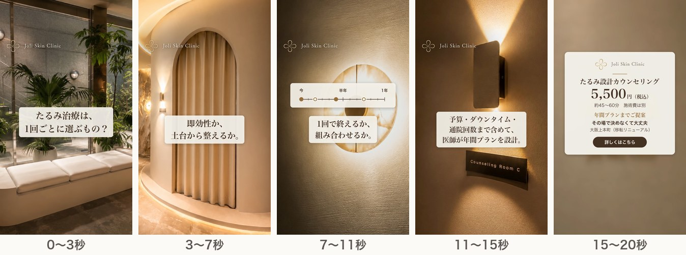
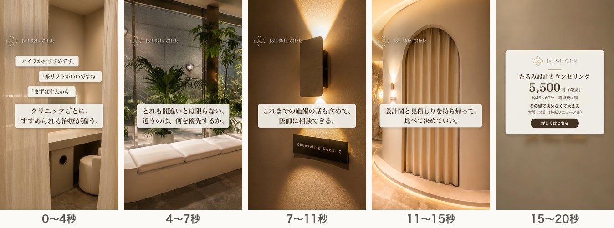

# 追加2案（D・E）の構成

2026年10月29日 ／ 社内検討用の資料です。クリニックの公式ページではありません。

A〜Cと重ならない視点で2案を追加した。LPに書いてあるのに広告でまだ使っていない価値と、競合3院の打ち出しで空いているところから作った。2本とも、A〜Cと同じ写真とRunwayの4カットで動画（字幕・ロゴ・BGM入り、ナレーションなし）を書き出し済み。[動画を見る](videos.html)（GitHub Pages 上で再生）

## なぜこの2案か

A・B・Cはどれも「今、何を選ぶか」の話である。LPにはそれ以外に、まだ広告にしていない価値が2つある。

| LPに書いてあること（広告で未使用） | 競合3院の打ち出し | 案 |
|---|---|---|
| 「即効性を求めるべきか、土台から整えるべきか」「1回で完結か、複数回・組み合わせか」「予算・ダウンタイム・通院回数を加味した現実的なプラン」、FAQ「年間プランまでご提案可能」 | YUTAKA：院長が担当・相談料3,300円／Urara：VECTRAの3D画像／ロジック：部位や痛みへの不安。長い期間の計画を入口にしている院はない | D |
| こんな方に「複数のクリニックで違う提案を受け、判断に迷っている方」「何度か施術を受けてきたが、効果に納得できていない方」 | 3院とも初めての人に向けた説明が中心。ほかの院の提案と比べたい人に向けた打ち出しはない | E |

競合は公式サイトの打ち出しを比べたもので、競合の広告やその成果は見ていない。

## 5案の分担

| 案 | 視点 | 狙う人 |
|---|---|---|
| A「結局どれがいいの？」 | 機械の名前で迷う | 調べて比べている人 |
| B「たるみの原因は、ひとつじゃない」 | 原因（層） | 理由から知りたい人 |
| C「決める前に、相談だけ。」 | 当日の流れ・即決しなくていい | 初めてで不安な人 |
| D「1回より、1年で考える。」 | 時間（1年の計画・予算） | 長く続けることや費用を考える人 |
| E「提案が、クリニックごとに違う。」 | 比較・見直し | ほかの院で相談・施術を受けたことがある人 |

## D「1回より、1年で考える。」（約20秒）

1回ごとに施術を選ぶのではなく、予算・ダウンタイム・通院回数を含めて1年の計画で考える、という視点。単発の施術を受けてきた人や、費用が気になって踏み出せない人に向ける。

| 秒 | 画面 | 字幕 | ナレーション |
|---|---|---|---|
| 0〜3 | P2 待合（Runway・横にスライド） | たるみ治療は、1回ごとに選ぶもの？ | 字幕と同じ |
| 3〜7 | P1 アーチ（Runway・前進） | 即効性か、土台から整えるか。 | 字幕と同じ |
| 7〜11 | P7 照明（Runway・暗め）＋「今／半年／1年」の目盛りに点が4つ置かれる図 | 1回で終えるか、組み合わせるか。 | 字幕と同じ |
| 11〜15 | P4 Counseling Room（ゆっくり拡大） | 予算・ダウンタイム・通院回数まで含めて、医師が年間プランを設計。 | 字幕と同じ |
| 15〜20 | P8＋終わりの案内 | 共通の案内に「年間プランまでご提案」を追加 | たるみ設計カウンセリング、5,500円。 |

目盛りの図は施術名や回数を示さない。点の形（塗りと輪）を変えて「組み合わせる」ことを表すだけにした。

## E「提案が、クリニックごとに違う。」（約20秒）

ほかの院での提案や施術を否定せず、比べるための材料を渡す、という視点。持ち帰れる設計図と見積もりを「比べて決めていい」という形で見せる。すでに何院か相談した人や、施術を見直したい人に向ける。

| 秒 | 画面 | 字幕 | ナレーション |
|---|---|---|---|
| 0〜4 | P5 パウダースペース（Runway）＋提案カードが3枚重なる（「ハイフがおすすめです」「糸リフトがいいですね」「まずは注入から」） | クリニックごとに、すすめられる治療が違う。 | 字幕と同じ（カードが重なる最初の約1秒は声なし） |
| 4〜7 | P2 待合（Runway） | どれも間違いとは限らない。違うのは、何を優先するか。 | 字幕と同じ |
| 7〜11 | P4 Counseling Room（ゆっくり拡大） | これまでの施術の話も含めて、医師に相談できる。 | 字幕と同じ |
| 11〜15 | P1 アーチ（Runway） | 設計図と見積もりを持ち帰って、比べて決めていい。 | 字幕と同じ |
| 15〜20 | P8＋終わりの案内 | 共通の案内 | たるみ設計カウンセリング、5,500円。 |

## 表現の注意

- Eは、ほかの院を悪く言う広告（比較して優れていると示す広告）にしない。「どれも間違いとは限らない」は外さない。提案カードに院名は出さない。
- LP冒頭の「他院のハイフや糸リフトで効果を感じなかった方へ」は、Eのフックに使わない。見る人の施術歴を決めつける形になり、Metaの「個人の特性」に関するポリシーにかかるおそれがある。使う場合は院の確認後に、フック違いとして試す。
- Dでは、LPの「10年後も自然な顔立ち」は効果の約束に読めるため、字幕にしない。
- LPにある「麻酔科医常駐」と「症例3,000件超」は使っていない。症例数は数え方が未確定のため。

## 配信への組み込み方

- 1日5,000円の予算で5本を同時に出すと、1本あたりの判断材料が足りない。A・B・Cは予定どおり11月9日から出す。
- 1週目（〜11月15日）の3秒視聴率・リンクCTR・Lead単価を見て、下位の1〜2本をD・Eと入れ替え、11月16日〜22日に試す。続ける案は、予定どおり11月24日ごろに決める。
- LPのURLには、A〜Cと同じく utm_content（D／E）を付ける。

## 院への確認（追加分）

- E「これまでの施術の話も含めて、医師に相談できる」：LPの対象者の書き方から読み取ったもので、LPに明記はない。カウンセリングで過去の施術歴を踏まえて相談できるか。
- D「医師が年間プランを設計」：LPのFAQ「年間プランまでご提案可能」に基づく。カウンセリングの担当医師が、年間プランまで出す運用でよいか。

## 制作の状況

- 2本とも縦（9:16）とフィード用（4:5）を書き出し済み。字幕・ロゴ・終わりの案内・BGM入りで、ナレーションはまだない。
- 新しく作ったのは、Dの目盛りの図とEの提案カードだけ。映像はA〜Cと同じ公式サイトの写真とRunwayの4カット。
- ナレーション（AI音声）の原稿に、D・Eの10行を追加した。D_04・E_01・E_02は字幕の時間より長くなる見込みで、音声を入れるとその分だけ尺が延びる。
- BGMはPixabayの「Aesthetic vibes」（FebbyBacksound、Content ID登録なし、商用利用可・クレジット不要）。A〜Eの全本に入れた。
