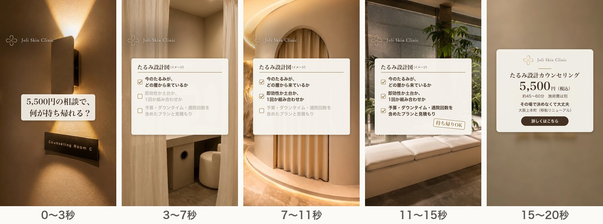
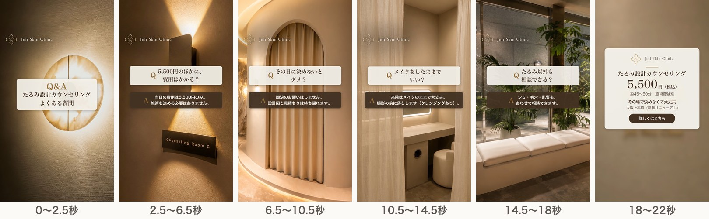

# 追加2案（F・G）の構成

2026年10月30日 ／ 社内検討用の資料です。クリニックの公式ページではありません。

A〜Eと視点の違う2案を、さらに追加した。院のYouTube・Instagramも素材として確認したが、代表・医師が話す映像、人物の写真、告知が中心で、方針上そのまま使える映像はほとんどなかった。そのため映像はA〜Eと同じ公式サイトの写真とRunwayの4カットのまま、見せ方と言葉を変えた。2本とも動画（字幕・ロゴ・BGM入り、ナレーションなし）を書き出し済み。[動画を見る](videos.html)（GitHub Pages 上で再生）

## なぜこの2案か

| LPに書いてあること | 今の案との違い | 案 |
|---|---|---|
| 「含まれるもの：肌画像解析・3D画像分析・治療設計・お見積もり」「カウンセリングでわかること」「設計図とお見積もりは、お持ち帰りいただけます」 | Cは当日の流れ、Fは持ち帰る成果物を見せる。相談の中身を具体的に書いた画像広告04は、LP閲覧19件で良し悪しをまだ判断できていない | F |
| 「よくあるご質問」（5,500円のほかの費用、即決、メイク、たるみ以外の相談） | LPを見た人のうち予約ボタンを押したのは約8%で、9割強は押さずに離れている。A〜Fは初めて見る人向け、GはLPを見た人に向けて、予約の手前の疑問に先に答える | G |

## 7案の分担

| 案 | 視点 | 狙う人 |
|---|---|---|
| A「結局どれがいいの？」 | 機械の名前で迷う | 調べて比べている人 |
| B「たるみの原因は、ひとつじゃない」 | 原因（層） | 理由から知りたい人 |
| C「決める前に、相談だけ。」 | 当日の流れ・即決しなくていい | 初めてで不安な人 |
| D「1回より、1年で考える。」 | 時間（1年の計画・予算） | 長く続けることや費用を考える人 |
| E「提案が、クリニックごとに違う。」 | 比較・見直し | ほかの院で相談・施術を受けたことがある人 |
| F「5,500円で、何が持ち帰れる？」 | 相談の成果物 | 5,500円に見合う中身があるか迷っている人 |
| G「よくある質問、先に答えます。」 | 予約前の疑問 | LPを見たが予約しなかった人（リターゲティング） |

## F「5,500円で、何が持ち帰れる？」（約20秒）

紙のような「たるみ設計図（イメージ）」のカードを出し、背景の場面が変わるごとに項目に1つずつチェックを入れる。最後に「持ち帰りOK」の印を押す。項目はLPの「カウンセリングでわかること」と同じ。

| 秒 | 画面 | 字幕・カード | ナレーション |
|---|---|---|---|
| 0〜3 | P4 Counseling Room（ゆっくり拡大） | 5,500円の相談で、何が持ち帰れる？ | 画面と同じ |
| 3〜7 | P5 パウダースペース（Runway）＋設計図のカード | ✓ 今のたるみが、どの層から来ているか | ひとつ目。今のたるみが、どの層から来ているか。 |
| 7〜11 | P1 アーチ（Runway）＋カード | ✓ 即効性か土台か、1回か組み合わせか | ふたつ目。即効性か土台か、1回か、組み合わせか。 |
| 11〜15 | P2 待合（Runway）＋カード | ✓ 予算・ダウンタイム・通院回数を含めたプランと見積もり／「持ち帰りOK」の印 | みっつ目。予算、ダウンタイム、通院回数を含めたプランと見積もり。 |
| 15〜20 | P8＋終わりの案内 | 共通の案内 | たるみ設計カウンセリング、5,500円。 |

カードは実物の書式ではないため、「（イメージ）」と入れた。チェック前の項目は薄く、チェック後に濃くして、相談で中身が埋まっていく様子を表す。

## G「よくある質問、先に答えます。」（約22秒）

「Q&A」の表紙のあと、質問（白い帯）と答え（ブラウンの帯）を場面ごとに4問出す。答えはすべてLPの「よくあるご質問」に沿う。

| 秒 | 画面 | 質問 | 答え |
|---|---|---|---|
| 0〜2.5 | P7 照明（Runway・暗め） | 表紙「Q&A たるみ設計カウンセリング よくある質問」 | — |
| 2.5〜6.5 | P4 Counseling Room | 5,500円のほかに、費用はかかる？ | 当日の費用は5,500円のみ。施術を決める必要はありません。 |
| 6.5〜10.5 | P1 アーチ（Runway） | その日に決めないとダメ？ | 即決のお願いはしません。設計図と見積もりは持ち帰れます。 |
| 10.5〜14.5 | P5 パウダースペース（Runway） | メイクをしたままでいい？ | 来院はメイクのままで大丈夫。撮影の前に落とします（クレンジングあり）。 |
| 14.5〜18 | P2 待合（Runway） | たるみ以外も相談できる？ | シミ・毛穴・肌質も、あわせて相談できます。 |
| 18〜22 | P8＋終わりの案内 | 共通の案内 | — |

ナレーションは質問と答えを続けて読む。声を入れると約30秒になる見込み。

## 表現の注意

- Fのカードは「（イメージ）」と明記する。実物の設計図と見た目や項目が大きく違うと誤解を招くため、院の書式と照らし合わせる。患者の情報や顔の画像は入れない。金額は出さない。
- Gの答えはLPの文言から外れないようにする。「実質無料」「キャッシュバック」は入れない。
- 2本とも、見る人の状態を決めつける言い方（「あなたのたるみ」など）はしていない。

## 配信への組み込み方

- Fは、A〜Eと同じ広告セットで試す。1週目の結果を見て、下位の案と入れ替える候補にする（D・Eと同じ扱い）。
- Gは、A〜Fとは別に、LPを見た人・動画を見た人に向けたリターゲティングの広告セットで出す。予算は1日1,000〜1,500円程度。
- LPのURLには utm_content（F／G）を付ける。

## 院への確認（追加分）

- F：実際に持ち帰る設計図の書式（空欄の見本でよい）を1枚もらい、カードの見た目と項目が大きく違わないか確認する。
- G：4つの答え（当日の費用、即決なし、メイクとクレンジング、たるみ以外の相談）が、今の運用どおりか。

## 制作の状況

- 2本とも縦（9:16）とフィード用（4:5）を書き出し済み。字幕・ロゴ・終わりの案内・BGM入りで、ナレーションはまだない。
- BGMは今「Aesthetic vibes」。A〜Gの全本について、Pixabayの別の2曲（Relaxing Piano Ambient、Spa）に差し替えた版も作り、聞き比べている。
- ナレーション（AI音声）の原稿に、F・Gの11行を追加した（全37行）。
