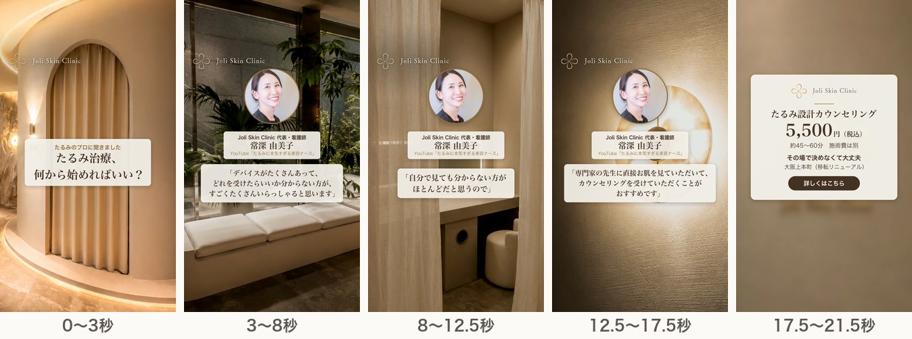
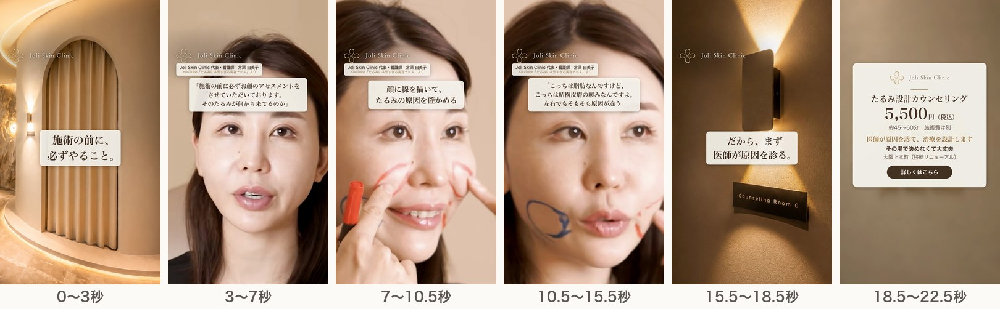

# 追加2案（H・I）の構成：代表のYouTube映像を使う案

2026年11月2日 ／ 社内検討用の資料です。クリニックの公式ページではありません。

常深代表（看護師）の映像を広告に使ってよいと確認できたため、代表のYouTubeの映像を主役にした2案を考えた。代表は、LPと同じ結論（機械より先に原因を見る、先生に診てもらう）を自分の言葉で話している。発言は自動字幕から起こして秒数を確かめた（字幕には聞き違いがあるため、元データを受け取ったら音声で確認する）。Hは公式サイトの代表の写真、Iは代表のYouTubeの画面のスクショを使い、2本とも静止画版（発言は字幕）を作った。動画のファイルが届けば、本人の声が入った版に作り替えられる。[動画を見る](videos.html)（GitHub Pages 上で再生）

## 2案の考え方

| 案 | 使う動画 | 視点 | A〜Gとの違い |
|---|---|---|---|
| H「たるみのプロが、最初にすすめること」 | 【保存版】ボルニューマ・ソフウェーブ・ザーフ…結局どれがいい？たるみタイプ別に解説！（2026年10月公開、8:12） | 迷っている人への答えを、代表が本人の声で言う | A〜Gは字幕だけで伝えていた。Hは「たるみに本気すぎる美容ナース」として発信している本人が話す |
| I「施術の前に、必ずやること」 | 【完全保存版】ザーフ人気No.1の理由｜「横顔・中顔面・口横」まで計算するこだわり照射（2026年9月公開、21:51） | 顔に線を描いて原因を確かめる場面を、実際の映像で見せる | Bは原因（層）を文字で示した。Iは同じ顔でも左右で原因が違うことを、本物の場面で見せる |

## H「たるみのプロが、最初にすすめること」（約23秒）

| 秒 | 映像（元の動画と秒数） | 代表の発言（音声そのまま） | 字幕・画面の文字 |
|---|---|---|---|
| 0〜9 | たるみタイプ別 0:18.5〜0:27.5 | 「たくさんデバイスがあって、当院にも7種類8種類ぐらいのたるみのデバイスがあるので、どれを受けたらいいかわからないって方がすごくたくさんいらっしゃると思う」 | 上部に大きく「たるみ治療、結局どれ？」。発言はすべて字幕にする |
| 9〜11 | 新院の写真（P1 アーチ、Runway） | — | 「じゃあ、何から始めればいい？」 |
| 11〜19.5 | たるみタイプ別 7:27.0〜7:35.5 | 「自分で見ても分からない方がほとんどだと思うので、是非専門家の先生に直接お肌を見ていただいて、カウンセリングを受けていただくことがお勧めです」 | 発言の字幕。下部に「Joli Skin Clinic 代表・看護師 常深由美子」 |
| 19.5〜23.5 | P8＋終わりの案内 | — | 共通の案内 |

### Hの静止画版（制作済み・約21.5秒）

動画のファイルがなくても作れるよう、公式サイトの代表の紹介写真を丸く切り抜き、名前・肩書きと、上の2つの発言を字幕で出す形にした。背景は新院の写真とRunwayの映像を暗めにして使う。代表の言葉をAI音声で読むと本人の声と誤解されるため、ナレーションは入れない（BGMのみ）。写真はAIで動かさない。

| 秒 | 画面 | 字幕 |
|---|---|---|
| 0〜3 | P1 アーチ（Runway） | たるみのプロに聞きました／たるみ治療、何から始めればいい？ |
| 3〜8 | P2 待合（暗め）＋代表の写真・名前・肩書き | 「デバイスがたくさんあって、どれを受けたらいいか分からない方が、すごくたくさんいらっしゃると思います」 |
| 8〜12.5 | P5 パウダースペース（暗め）＋代表の写真 | 「自分で見ても分からない方がほとんどだと思うので」 |
| 12.5〜17.5 | P7 照明（暗め）＋代表の写真 | 「専門家の先生に直接お肌を見ていただいて、カウンセリングを受けていただくことがおすすめです」 |
| 17.5〜21.5 | P8＋終わりの案内 | 共通の案内 |

## I「施術の前に、必ずやること」（約25秒）

| 秒 | 映像（元の動画と秒数） | 代表の発言（音声そのまま） | 字幕・画面の文字 |
|---|---|---|---|
| 0〜7 | こだわり照射 0:45〜0:52 | 「施術の前に必ずお顔のアセスメントをさせていただいております。そのたるみが何から来てるのかっていうところですね」 | 上部に大きく「施術の前に、必ずやること。」 |
| 7〜16 | こだわり照射 1:59〜2:08（顔に線を描いた状態で、左右を触って説明） | 「こっちは脂肪なんですけど、こっちは結構皮膚の緩みなんですよ。左右でもそもそも原因が違う」 | 「同じ顔でも、左右で原因が違う」 |
| 16〜21 | こだわり照射 21:13〜21:18 | 「施術の前はこのようにしっかりデザインをして、ご要望をお聞きしながら」 | 「だから、まず原因から設計する」 |
| 21〜25 | P8＋終わりの案内 | — | 共通の案内に「医師が原因を診て、治療を設計します」 |

### Iの静止画版（制作済み・約22.5秒）

院内の映像と、代表のYouTubeの場面を交互に見せる。代表の場面は、ユーザーが撮った画面のスクショ（元の画像、2940×1912）から顔の部分を縦長に切り抜き、画面いっぱいに使う（カードの枠には入れない）。焼き込みの文字（「Point」の帯、「脂肪に効くモード」、字幕、プレーヤーのボタン）は切り抜きから外し、左上のタイトルの帯の端が入る1枚は壁の色で塗りつぶした。写真はAIで動かさず、ゆっくり拡大するだけ。字幕は顔にかからないよう額のあたりに出す。代表の言葉なのでナレーションは入れない（BGMのみ）。ロゴの下に「Joli Skin Clinic 代表・看護師 常深由美子／YouTube『たるみに本気すぎる美容ナース』より」と出す。

| 秒 | 画面 | 字幕 |
|---|---|---|
| 0〜3 | P1 アーチ（Runway、院内） | 施術の前に、必ずやること。 |
| 3〜7 | 代表が話す場面（0:47ごろ） | 「施術の前に必ずお顔のアセスメントをさせていただいております。そのたるみが何から来てるのか」 |
| 7〜10.5 | 顔に線を描いている場面 | 顔に線を描いて、たるみの原因を確かめる |
| 10.5〜15.5 | 線を描いた頬を指している場面（2:05ごろ） | 「こっちは脂肪なんですけど、こっちは結構皮膚の緩みなんですよ。左右でもそもそも原因が違う」 |
| 15.5〜18.5 | P4 Counseling Room（院内） | だから、まず医師が原因を診る。 |
| 18.5〜22.5 | P8＋終わりの案内 | 共通の案内に「医師が原因を診て、治療を設計します」 |

## 使わない部分

- 「友達が受けて良かったから私も同じものを、は実は結構危険」（たるみタイプ別 0:00〜0:10、0:26〜0:35）：不安をあおる言い方になる。
- 「ほとんどのクリニックは自分のクリニックにある機械をおすすめする」（たるみタイプ別 7:36〜7:55）、「どこで受けても同じっていうわけではない」（こだわり照射 0:27〜0:40）：ほかの院と比べて優れていると示す表現になる。
- 「〜に効くモード」「綺麗な輪郭を作る」など効果をうたう言葉、体験談（「自分の中でも効果を実感した」）、半顔比較、施術後の状態。
- 公開中の動画に焼き込まれた字幕・効果音・写真素材（モデルの写真、メーカーの製品画像）。

## 表現の注意

- 代表は看護師なので、診断や治療の決定をしているように見せない。Hは「専門家の先生に」、Iは「医師が原因を診て」で締め、LPの「医師が担当」とそろえる。
- 名前と肩書き（代表・看護師）を画面に出す。
- Iはザーフの施術の場面を使う。機器名は字幕に出さず、機械の画面やロゴが大きく映る部分は切る。ザーフが国内未承認の機器の場合、施術の場面を広告に使ってよいか（必要な説明を添えるか）を院に確認する。
- 横長の動画を縦（9:16）に切り出す。代表は画面の中央にいるため、切り出しやすい。

## 院にお願いする素材

公開中の動画は字幕や効果音が焼き込まれているため、編集前の元データ（撮影したままの動画）を、院か動画の編集担当からもらう。YouTubeからのダウンロードは規約に反するため行わない。

| 動画 | URL | 使う部分 | 用途 |
|---|---|---|---|
| 結局どれがいい？たるみタイプ別に解説！ | https://www.youtube.com/watch?v=PcePwquxlRk | 0:15〜0:30、7:20〜7:40（前後に余裕をもたせる） | H |
| ザーフ人気No.1の理由｜こだわり照射 | https://www.youtube.com/watch?v=RQ6fcnKvxQ4 | 0:40〜0:55、1:40〜2:15、21:05〜21:25 | I |

秒数は公開版のもの。元データでは位置がずれるため、発言の言葉で探してもらう。

## 院への確認（追加分）

- 代表の映像（発言・施術の場面）を広告に使うこと。代表本人の了承も含む。
- Iで、施術を受けている人（代表本人）の顔を広告に使うこと。
- ザーフの施術の場面を広告に使ってよいか。

## 配信への組み込み方

- H・Iは本人が話す動画で、A〜Gとは見た目も伝わり方も違う。2週目の入れ替えでは、H・Iを優先して試す価値がある。
- 院の発信で反応が大きかった「結局どれがいい？」「実は原因は○○」の型を、本人の声でそのまま広告にする形になる。
